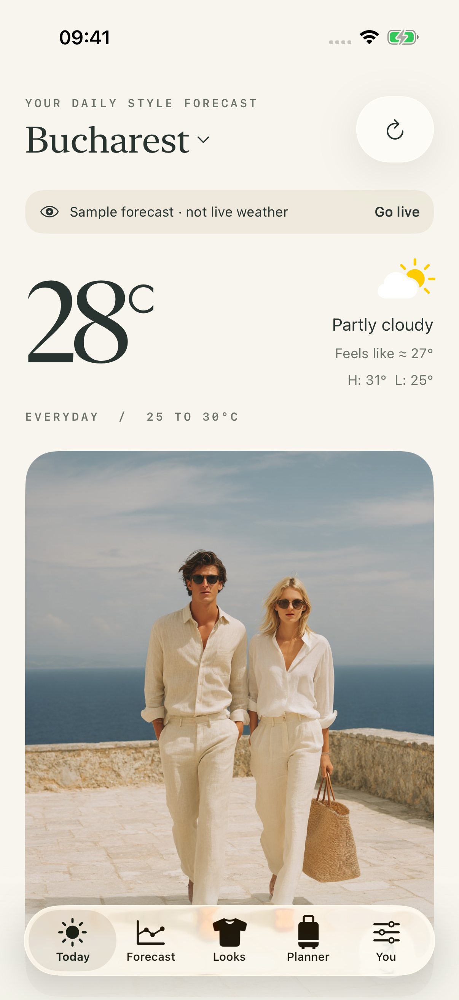
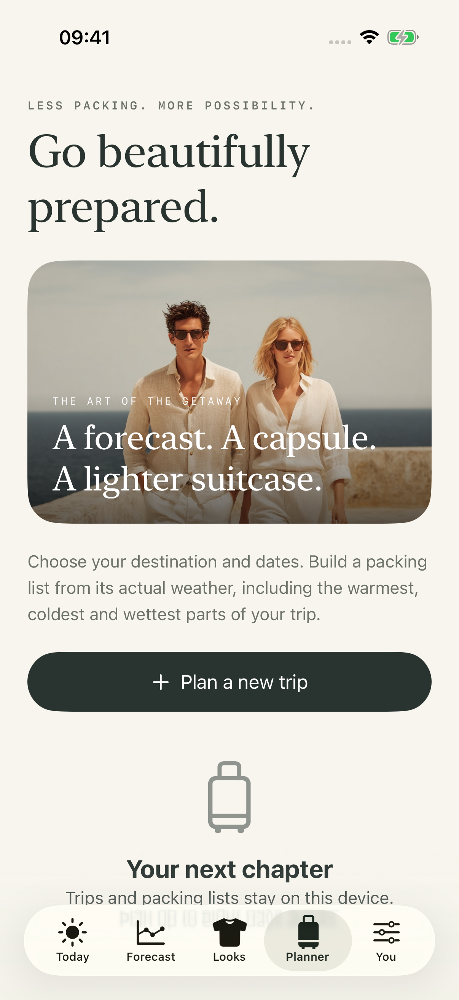

# Dress by the Weather

A native iPhone, iPad and Android weather stylist: your forecast, translated into thoughtful layers. SwiftUI, original fashion imagery, Liquid Glass navigation, no login and no advertising.

## Preview

<p> </p>

See [the image coverage and temperature guide](Art/README.md) for the reviewed wardrobe library.

## Android

The native Jetpack Compose edition shares all 214 approved photographs, eight guides and the iOS styling rules. See [Android build and validation](Android/README.md), [Google Play release record](GooglePlay/RELEASE.md), [reviewer guide](GooglePlay/ReviewerWalkthrough.md) and [Android privacy policy](https://www.oanarinaldi.com/dressbytheweatherandroidprivacy.html). Android uses licensed Source Serif and Inter fonts, native system permissions and Google Play Billing for the same one-time Pro upgrade.

## Run on iOS

Requires Xcode 26 or later, iOS 26 or later, and [XcodeGen](https://github.com/yonaskolb/XcodeGen).

```sh
xcodegen generate
open DressByTheWeather.xcodeproj
swift test --package-path Core
```

Choose your development team for device builds. The project uses `com.oanarinaldi.dressbytheweather` and an app group for the widget. Simulator builds need no account, API key, backend or paid weather subscription.

## Included

- Optional current location and worldwide city/address search through Apple MapKit.
- Free global MET Norway forecasts with an identifying User-Agent, four-decimal coordinates, conditional GETs, disk caching, request coalescing and rate-limit backoff.
- Hourly forecasts, available daily forecasts, destination-local time zones and temperature charts.
- Ten temperature bands, four occasions, rain/snow/wind overrides and personal comfort calibration.
- Outfit details, local favourites, sharing, an hourly outfit timeline, destination packing lists and local reminders.
- Home Screen and Lock Screen widgets with explicit update timestamps and stale-data handling.
- A separate, clearly labelled sample forecast. Failed requests never silently become fabricated live weather.

## Weather cost

Weather comes from [MET Norway Locationforecast](https://api.met.no/weatherapi/locationforecast/2.0/documentation), which provides global coordinate-based forecasts without a key. Data is licensed under [CC BY 4.0](https://api.met.no/doc/License), including commercial reuse with attribution. The app conservatively caches each place for at least three hours, honours longer HTTP expiry and revalidates with `If-Modified-Since`. It does not poll from the background.

The provider has no SLA. Respect the [terms of service](https://api.met.no/doc/TermsOfService), including the aggregate traffic limit and requirement for a caching gateway as usage grows. The app owner must review and accept the provider terms before public operation. A direct request exposes the requested coordinates and the device's IP address to MET Norway; the in-app privacy page explains this.

Daily ranges are calculated from available forecast samples. Forecast intervals widen later in the horizon. Feels-like values are labelled estimates computed from temperature, humidity and wind; unavailable provider fields are not invented.

## Editorial photography

`Art/catalogue.json` defines 64 weather/occasion collections with 256 planned candidates. The app bundles 214 approved couple photographs after rejecting unsuitable footwear, framing or extra people. `Art/prompts.txt` contains the reproducible Midjourney prompts. Generated originals retain job IDs. Only visually reviewed variants are imported into `App/Assets.xcassets` with `Scripts/import_art.py`.

When a matching photograph is not bundled, the app displays a clothing checklist graphic. It never substitutes sunny summer styling for a winter or rain outfit. All bundled photographs use fictional models generated in Midjourney; the owner’s supplied reference photograph is not distributed. Reviewed alternatives within the same weather and temperature range cover four rejected rain collections. Midjourney usage rights depend on the owner's subscription and terms.

## Validation

The Swift package tests temperature boundaries, cold/rain/snow overrides, wind chill, comfort calibration, sparse MET responses and thousands of weather/style combinations. Thirteen core tests cover weather styling and wardrobe/capsule matching. Xcode UI tests cover free weather flows, worldwide Sydney search and packing, Pro wardrobe persistence, weekly planning, capsules, editorial guides, and StoreKit purchase cancellation, verified unlock, relaunch, restoration and refund revocation.

## Release

See [AppStore/RELEASE.md](AppStore/RELEASE.md) for the release record and [the captioned review walkthrough](AppStore/REVIEW_VIDEO.md) for a feature tour. Source, prepared assets, prompts and metadata are versioned here; signing credentials and build products are excluded. Weather and the core daily styling tools remain free. Optional **Pro is a US $19.99 one-time permanent unlock**, with localized App Store pricing and no subscription. Pro adds seven-day outfit planning, a private photo wardrobe, travel capsules that reuse suitable pieces, and the full 214-photo editorial library with eight original styling guides. See [Pro features and purchase behavior](AppStore/PRO.md).

[Privacy policy](https://www.oanarinaldi.com/dressbytheweatherprivacy.html).
